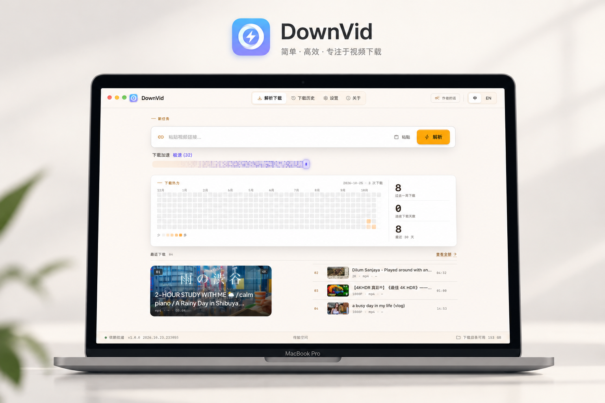

<div align="center">


<h1>DownVid</h1>

<p><strong>Save the videos you like, locally.</strong></p>
<p>Open source · Cross-platform · Simple</p>



<p>
  <a href="https://github.com/Downvid/downvid/releases"></a>
  <a href="https://github.com/Downvid/downvid/releases/latest"></a>
  <a href="https://github.com/Downvid/downvid/stargazers"></a>
  <a href="https://alternativeto.net/software/downvid/"></a>
  <a href="https://github.com/Downvid/downvid/actions/workflows/codeql.yml"></a>
  <a href="./LICENSE"></a>
</p>

<p>
  <a href="https://downvid-coral.vercel.app">Website</a>
  ·
  <a href="https://github.com/Downvid/downvid/releases">Download</a>
  ·
  <a href="https://afdian.com/a/xynrin">Sponsor (Afdian)</a>
  ·
  <a href="https://github.com/Downvid/downvid/issues">Report an issue</a>
  ·
  <a href="./docs/installation.md">Installation guide</a>
</p>

<p>
  <a href="./README.md">简体中文</a> | <strong>English</strong>
</p>

<p>
  <a href="https://www.producthunt.com/products/github-460eee39-2e5c-447d-b207-531e944feebd?embed=true&amp;utm_source=badge-featured&amp;utm_medium=badge&amp;utm_campaign=badge-downvid" target="_blank" rel="noopener noreferrer"></a>
  <a href="https://trendshift.io/repositories/180707?utm_source=trendshift-badge&amp;utm_medium=badge&amp;utm_campaign=badge-trendshift-180707" target="_blank" rel="noopener noreferrer"></a>
</p>
</div>

---

## Sponsorship and business

If DownVid helps you, consider buying the author a coffee to support maintenance and continuous updates:

<table>
  <tr>
    <td align="center" width="260" valign="top">
      <br /><br />
      <b>WeChat Pay Tip</b>
    </td>
    <td align="center" width="260" valign="top">
      <a href="https://afdian.com/a/xynrin" target="_blank" rel="noopener noreferrer">
        
      </a><br /><br />
      <b><a href="https://afdian.com/a/xynrin" target="_blank" rel="noopener noreferrer">Sponsor on Afdian</a></b>
    </td>
  </tr>
</table>

- ⚡ **Afdian**: [https://afdian.com/a/xynrin](https://afdian.com/a/xynrin)
- ☕ **WeChat Pay**: Scan the QR code above to tip the author
- 💖 **Other sponsorship options**: [xynrin@icloud.com](mailto:xynrin@icloud.com?subject=%5BDownVid%5D%20Sponsor)
- 💼 **Business enquiries / Ads**: [xynrin@icloud.com](mailto:xynrin@icloud.com?subject=%5BDownVid%5D%20Business)

**The software is completely open source, contains no ads and never will.** Please report issues or suggestions via [GitHub Issues](https://github.com/Downvid/downvid/issues).

---

> [!IMPORTANT]
> This project is a graphical front end for [yt-dlp](https://github.com/yt-dlp/yt-dlp). It contains no code for
> cracking or circumventing technical protection measures. Please follow your local laws, platform terms and
> copyright requirements; you are responsible for how you use it.

## Contents

- [Sponsorship and business](#sponsorship-and-business)
- [About](#about)
- [Features](#features)
- [Supported sites](#supported-sites)
- [Install](#install)
- [Build from source](#build-from-source)
- [Documentation](#documentation)
- [Tech stack and architecture](#tech-stack-and-architecture)
- [Project layout](#project-layout)
- [FAQ](#faq)
- [Contributing](#contributing)
- [Star history](#star-history)
- [License and credits](#license-and-credits)

## About

**DownVid** is a modern, high-performance, open-source desktop video downloader for **macOS**, **Windows**, and **Linux**.

Built as a graphical frontend for [yt-dlp](https://github.com/yt-dlp/yt-dlp) and [FFmpeg](https://ffmpeg.org/), it removes the complexity of command-line tools and provides a clean, native, and ad-free experience.

### Why DownVid?

- 🌐 **1000+ Platforms Supported**: Seamlessly extracts high-quality video and audio across YouTube, Bilibili, Douyin, TikTok, Xiaohongshu, Kuaishou, Twitter/X, Instagram, and more.
- ⚡ **Built-in Acceleration**: Optimized multi-part chunk worker queues (up to 16 threads) and optional aria2 integration ensure lightning-fast downloads.
- 🔒 **Zero Ads & Privacy-Focused**: No popups, no bundled junkware, no telemetry, and no forced watermarks. Fully open source under the MIT license.
- 📦 **Automated Dependency Management**: Built-in Go sidecar detects and manages yt-dlp / FFmpeg, with one-click install into `~/.downvid/runtime/bin` — no environment variables.
- 🎨 **Modern Native UX**: Clean Material 3 design crafted with Svelte 5 and Wails v2.

## Features

| Feature | Description |
| --- | --- |
| 1000+ Sites | Powered by yt-dlp; dedicated parsers for Douyin and Kuaishou |
| Quality & Formats | 360P to 4K, audio-only (MP3), subtitles-only (SRT), and YouTube multi-audio tracks |
| Download Manager | Queue management, pause, resume, retry, download progress, speed, ETA, and file size |
| Acceleration | Chunked worker queue (default 8, up to 16 connections), optional aria2 |
| Authenticated Content | Import cookies from installed browsers or import `cookies.txt` |
| Runtime Dependencies | Detects manual paths and `~/.downvid/runtime/bin`; one-click download when missing |
| History | Tracks your last 100 downloads with quick reveal in file manager |
| Auto Update | Built-in updater via GitHub Releases with silent in-place installation |

## Supported sites

DownVid supports **1000+ sites** via yt-dlp, including:
- **Domestic**: Douyin, Kuaishou, Xiaohongshu, Bilibili, Xigua
- **International**: YouTube, TikTok, Instagram, Twitter/X, Facebook, and more

## Download & Install

Download from [**GitHub Releases**](https://github.com/Downvid/downvid/releases):

| Platform | Recommended Installer | Portable / Update Archive | Description |
|:---|:---|:---|:---|
| **macOS** | `DownVid-Wails-mac-universal-*.dmg` | `DownVid-Wails-mac-universal-*.zip` | Universal binary for both Apple Silicon and Intel |
| **Windows** | `DownVid-Wails-windows-x64-*-installer.exe` | `DownVid-Wails-windows-x64-*.zip` | NSIS installer with shortcuts or portable zip |
| **Linux** | `DownVid-Wails-linux-x64-*.deb` | `DownVid-Wails-linux-x64-*.tar.gz` | Debian/Ubuntu package or portable archive |

See the [Installation Guide](./docs/installation.md) for detailed steps.

## Build from source

### Prerequisites

- Node.js ≥ 22
- pnpm ≥ 8
- Go ≥ 1.25
- Wails CLI v2.16

### Steps

```bash
git clone https://github.com/Downvid/downvid.git
cd downvid
pnpm install
pnpm --dir app/frontend install

# Build standalone app with embedded sidecar
bash app/scripts/build.sh

# Live reload during development (without sidecar)
(cd app && wails dev)
```

## Tech stack and architecture

- **Framework**: [Wails v2](https://wails.io/)
- **Core Engine**: [Go](https://go.dev/) (16 zero-coupled internal packages)
- **Frontend**: [Svelte 5](https://svelte.dev/) + Vite + Tailwind CSS v4
- **Engines**: [yt-dlp](https://github.com/yt-dlp/yt-dlp) & [FFmpeg](https://ffmpeg.org/)
- **Updater**: [wmlUpdate](https://github.com/yxxbc/wmlUpdate) (source failover, resumable download, SHA-256 verification)
- **Testing**: [Vitest](https://vitest.dev/)

## License

DownVid is open source under the [MIT License](./LICENSE).

---

<div align="center">

<a href="https://github.com/Downvid/downvid">DownVid</a> · Made with care by Xynrin

</div>
