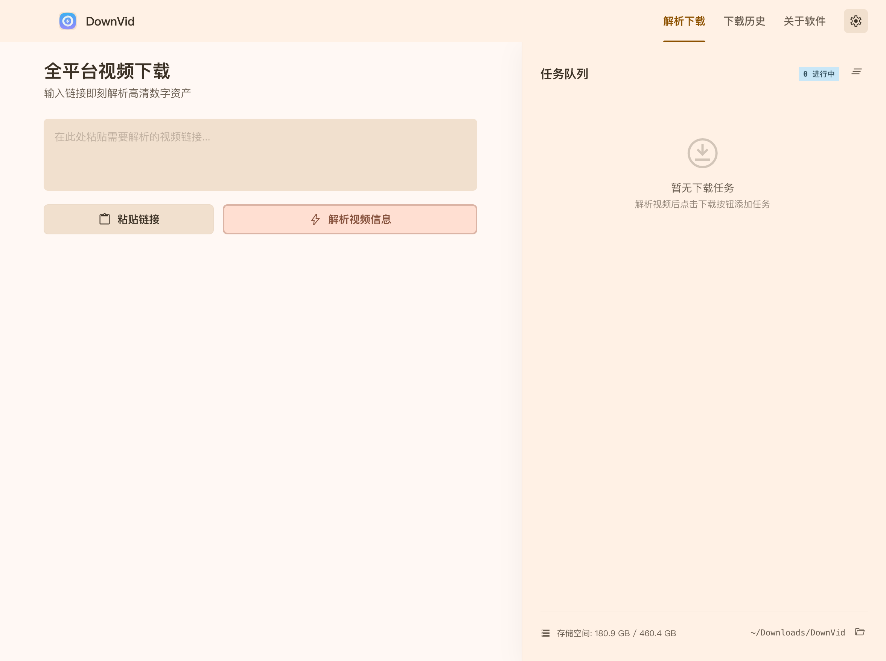
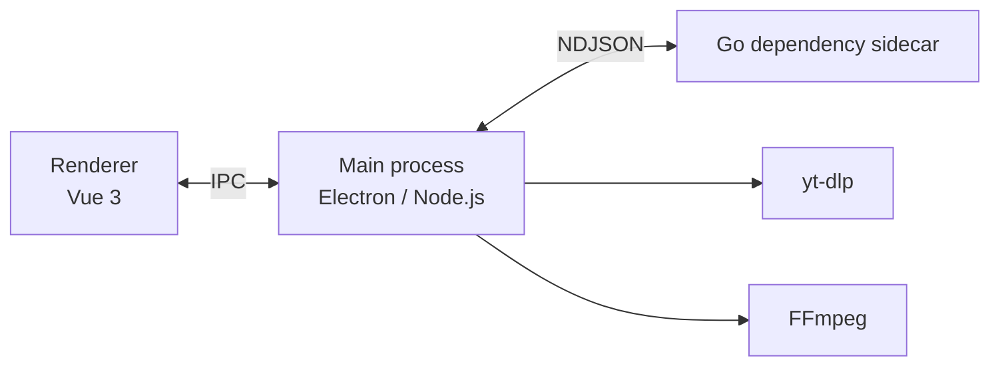

<div align="center">

<table>
  <tr>
    <td width="30%" align="center" valign="middle">
      
      <h1>DownVid</h1>
      <p><strong>Save the videos you like, locally.</strong></p>
      <p>Open source · Cross-platform · Simple</p>
    </td>
    <td width="70%" align="center" valign="middle">
      
    </td>
  </tr>
</table>

<p>
  <a href="https://github.com/yxxbc/downvid/releases"></a>
  <a href="https://github.com/yxxbc/downvid/releases/latest"></a>
  <a href="https://github.com/yxxbc/downvid/stargazers"></a>
  <a href="./LICENSE"></a>
</p>

<p>
  <a href="https://www.producthunt.com/products/github-460eee39-2e5c-447d-b207-531e944feebd?embed=true&amp;utm_source=badge-featured&amp;utm_medium=badge&amp;utm_campaign=badge-github-48115ca5-a95c-4dad-9887-1c9e47f4a589" target="_blank" rel="noopener noreferrer"></a>
</p>

<p>
  <a href="https://github.com/yxxbc/downvid/releases">Download</a>
  ·
  <a href="https://github.com/yxxbc/downvid/issues">Report an issue</a>
  ·
  <a href="./docs/installation.md">Installation guide</a>
</p>

<p>
  <a href="./README.zh-CN.md">简体中文</a> | <strong>English</strong>
</p>

</div>

---

> [!IMPORTANT]
> This project is a graphical front end for [yt-dlp](https://github.com/yt-dlp/yt-dlp). It contains no code for
> cracking or circumventing technical protection measures. Please follow your local laws, platform terms and
> copyright requirements; you are responsible for how you use it.

## Contents

- [About](#about)
- [Features](#features)
- [Supported sites](#supported-sites)
- [Install](#install)
- [Build from source](#build-from-source)
- [Documentation](#documentation)
- [Tech stack and architecture](#tech-stack-and-architecture)
- [Project layout](#project-layout)
- [FAQ](#faq)
- [Contributing](#contributing)
- [Star history](#star-history)
- [License and credits](#license-and-credits)

## About

**DownVid** is an open-source desktop video downloader for macOS, Windows and Linux. It uses
[yt-dlp](https://github.com/yt-dlp/yt-dlp) as its download engine and puts a clean graphical interface on top,
so you don't have to remember command-line flags.

The project is under active development. If you hit a problem or have a suggestion, please
[open an issue](https://github.com/yxxbc/downvid/issues).

## Features

| Feature | Description |
| --- | --- |
| Wide site support | 1000+ video and audio sites via yt-dlp; Douyin and Kuaishou have dedicated parsers |
| Quality and formats | 360P through 4K, audio-only (MP3), subtitles-only (SRT), YouTube multi-audio-track selection |
| Download management | Queue, pause, resume, retry, live progress with speed, ETA and file size |
| Download acceleration | Direct links use a small-chunk worker queue (8 by default, up to 16); optional aria2 multi-connection; concurrent HLS/DASH fragments |
| Logged-in content | Reads cookies from installed browsers, or import a `cookies.txt` manually |
| Runtime dependencies | Detects yt-dlp / FFmpeg already on your machine; downloads them in-app if missing |
| Download history | Keeps the last 100 downloads |
| Auto update | Updates through GitHub Releases; macOS verifies and swaps the app bundle in place |

## Supported sites

DownVid supports **1000+** video and audio sites through yt-dlp. A few common ones:

| China | International |
| --- | --- |
| Douyin, Xiaohongshu, Kuaishou, Xigua, Bilibili | YouTube, TikTok, Instagram, X (Twitter), Facebook |

For everything else see the [yt-dlp supported sites list](https://github.com/yt-dlp/yt-dlp/blob/master/supportedsites.md).
Availability can change as sites change.

## Install

Download the latest build from [**GitHub Releases**](https://github.com/yxxbc/downvid/releases) and pick the
package for your OS.

| Platform | Package |
| --- | --- |
| macOS | `.dmg` (ARM64 / x64) |
| Windows | `.exe` (x64) |
| Linux | `.AppImage` / `.deb` (x64 / ARM64; check the Release page for the exact artifacts) |

Step-by-step instructions and common issues are in the [installation guide](./docs/installation.md).

## Build from source

### Requirements

- Node.js ≥ 22
- pnpm ≥ 8
- Go ≥ 1.24

yt-dlp and FFmpeg do **not** need to be installed beforehand. At runtime DownVid detects and reuses whatever
is already on your machine, and can download them in-app when missing.

### Steps

```bash
git clone https://github.com/yxxbc/downvid.git
cd downvid
pnpm install
pnpm dev       # development
pnpm build     # package for the current platform
```

Per-platform build commands, dependency notes and troubleshooting are in the
[build from source guide](./docs/build-from-source.md).

## Documentation

| Document | Contents |
| --- | --- |
| [Installation](./docs/installation.md) | Install instructions for macOS, Windows and Linux |
| [Build from source](./docs/build-from-source.md) | Development environment, dependencies and build flow |
| [Troubleshooting](./docs/troubleshooting.md) | Common errors and how to diagnose them |
| [FAQ](./docs/faq.md) | Usage questions and answers |
| [Architecture](./docs/architecture.html) | Process structure, IPC and download flow |
| [Project structure](./docs/project-structure.md) | Directory guide and where to make changes |
| [Repository standards](./docs/standards.md) | Branch, commit, issue and PR conventions |
| [Release process](./docs/release.md) | Versioning and release artifact maintenance |
| [Contributing](./CONTRIBUTING.md) | How to contribute |
| [Security policy](./SECURITY.md) | How to report security issues |
| [Code of conduct](./CODE_OF_CONDUCT.md) | Community expectations |

> The in-depth docs are currently written in Chinese. Contributions that translate them are very welcome.

## Tech stack and architecture

### Tech stack

| Technology | Purpose |
| --- | --- |
| [Electron](https://www.electronjs.org/) | Cross-platform desktop shell |
| [Vue 3](https://vuejs.org/) | User interface |
| [TypeScript](https://www.typescriptlang.org/) | Type safety |
| [Tailwind CSS](https://tailwindcss.com/) | Styling |
| [Vite](https://vitejs.dev/) | Development and build |
| [Pinia](https://pinia.vuejs.org/) | State management |
| [Go](https://go.dev/) | Dependency sidecar that detects and installs yt-dlp / FFmpeg |
| [yt-dlp](https://github.com/yt-dlp/yt-dlp) | Video and audio extraction engine |
| [FFmpeg](https://ffmpeg.org/) | Merging and transcoding |
| [Vitest](https://vitest.dev/) | Pure-logic unit tests |

### Architecture overview



An interactive diagram with more detail is in the [architecture doc](./docs/architecture.html).

## Project layout

| Directory | Purpose |
| --- | --- |
| `backend/` | Go dependency sidecar: detects and installs runtime dependencies |
| `electron/` | Main process, IPC, download implementations, site parsers, updater |
| `src/` | Vue 3 renderer and UI |
| `shared/` | Repository coordinates and shared external links |
| `tests/` | Automated unit tests |
| `scripts/` | Build, manifest generation and validation scripts |
| `docs/` | Installation, build, architecture, maintenance and release docs |

See the [project structure doc](./docs/project-structure.md) for the full tree.

## FAQ

<details>
<summary><strong>It says yt-dlp or FFmpeg is missing. What now?</strong></summary>

The installer does not bundle them. DownVid looks for a usable copy already on your system at startup; if it
cannot find one, you can download it from the prompt, or manage it later under Settings → Runtime dependencies.
</details>

<details>
<summary><strong>macOS says the developer cannot be verified. What now?</strong></summary>

The first time you open it, right-click the app in Finder and choose **Open**, or allow it under
System Settings → Privacy & Security. If it still fails, see the [troubleshooting guide](./docs/troubleshooting.md).
</details>

<details>
<summary><strong>Some videos fail to download. What now?</strong></summary>

Many sites require you to be signed in. Make sure you are allowed to access the content, then let DownVid read
your browser session or import a `cookies.txt`. Site changes can also affect extraction success.
</details>

More in the [FAQ](./docs/faq.md) and [troubleshooting guide](./docs/troubleshooting.md).

## Contributing

Issues, documentation improvements and pull requests are all welcome.

Before submitting, please run:

```bash
pnpm vue-tsc --noEmit
pnpm test
pnpm lint:ipc
```

See the [contributing guide](./CONTRIBUTING.md) and [repository standards](./docs/standards.md) for the rest.

## Star history

<a href="https://www.star-history.com/?repos=yxxbc%2Fdownvid&type=date&legend=bottom-right">
  <picture>
    <source media="(prefers-color-scheme: dark)" srcset="https://api.star-history.com/chart?repos=yxxbc/downvid&type=date&theme=dark&legend=bottom-right" />
    <source media="(prefers-color-scheme: light)" srcset="https://api.star-history.com/chart?repos=yxxbc/downvid&type=date&legend=bottom-right" />
    
  </picture>
</a>

## License and credits

DownVid is released under the [MIT License](./LICENSE).

DownVid started from [Videdown](https://github.com/cshuangyy/videdown) and has since been substantially
modified, refactored and extended. Thanks to cshuangyy for the original work; the original copyright and
license notice is preserved in [LICENSE](./LICENSE).

Thanks also to the community contributors and to the maintainers of the projects we depend on:

- [Videdown](https://github.com/cshuangyy/videdown) — the original project
- [yt-dlp](https://github.com/yt-dlp/yt-dlp) — extraction engine
- [FFmpeg](https://ffmpeg.org/) — audio and video processing
- [Electron](https://www.electronjs.org/) · [Vue.js](https://vuejs.org/) · [Tailwind CSS](https://tailwindcss.com/) — app stack
- [Claude Code](https://www.anthropic.com/claude) — AI coding assistant

### Supporting the project

If DownVid is useful to you, you can buy the author a coffee. WeChat tip code:

<details>
<summary>Show tip code</summary>


</details>

---

<div align="center">

<a href="https://github.com/yxxbc/downvid">DownVid</a> · Made with care by yxxbc

</div>
