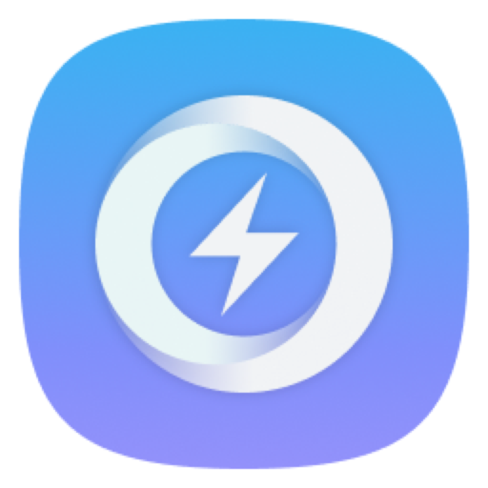
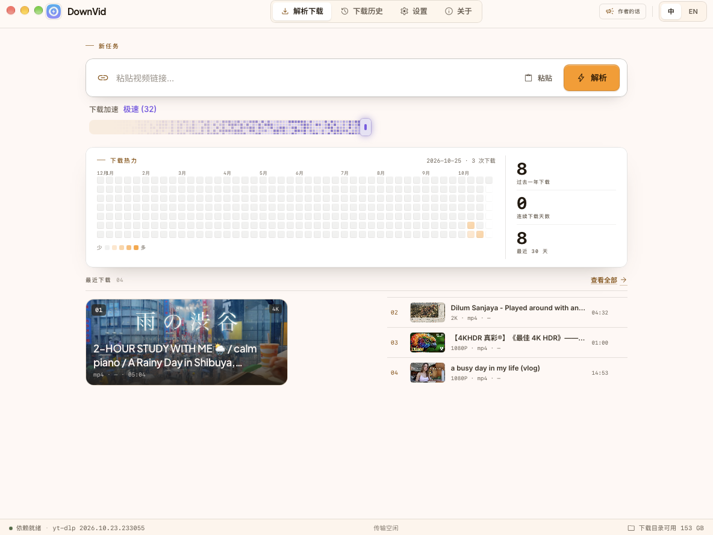
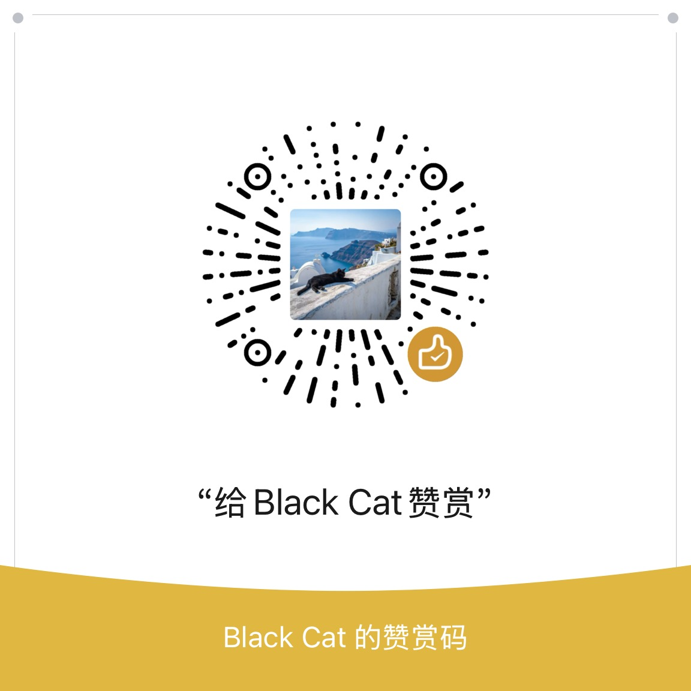
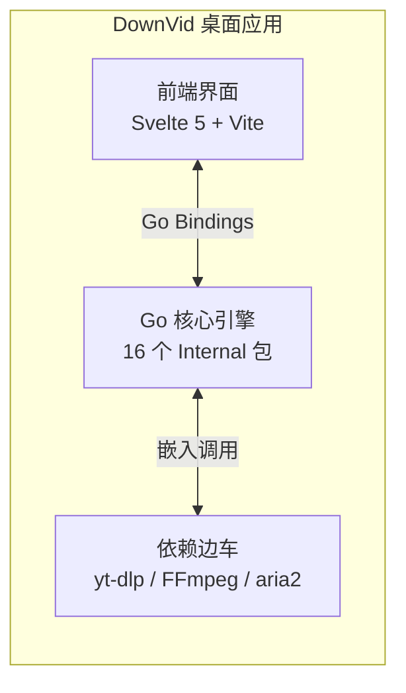

<div align="center">

<table>
  <tr>
    <td width="30%" align="center" valign="middle">
      
      <h1>DownVid</h1>
      <p><strong>把喜欢的视频，轻松保存到本地。</strong></p>
      <p>开源 · 跨平台 · 简洁易用</p>
    </td>
    <td width="70%" align="center" valign="middle">
      
    </td>
  </tr>
</table>

<p>
  <a href="https://github.com/Downvid/downvid/releases"></a>
  <a href="https://github.com/Downvid/downvid/releases/latest"></a>
  <a href="https://github.com/Downvid/downvid/stargazers"></a>
  <a href="https://alternativeto.net/software/downvid/"></a>
  <a href="https://github.com/Downvid/downvid/actions/workflows/codeql.yml"></a>
  <a href="./LICENSE"></a>
</p>

<p>
  <a href="https://downvid-coral.vercel.app">官网</a>
  ·
  <a href="https://github.com/Downvid/downvid/releases">下载 DownVid</a>
  ·
  <a href="https://afdian.com/a/xynrin">爱发电赞助</a>
  ·
  <a href="https://github.com/Downvid/downvid/issues">反馈问题</a>
  ·
  <a href="./docs/installation.md">安装指南</a>
</p>

<p>
  <strong>简体中文</strong> | <a href="./README.en.md">English</a>
</p>

<p>
  <a href="https://www.producthunt.com/products/github-460eee39-2e5c-447d-b207-531e944feebd?embed=true&amp;utm_source=badge-featured&amp;utm_medium=badge&amp;utm_campaign=badge-downvid" target="_blank" rel="noopener noreferrer"></a>
  <a href="https://trendshift.io/repositories/180707?utm_source=trendshift-badge&amp;utm_medium=badge&amp;utm_campaign=badge-trendshift-180707" target="_blank" rel="noopener noreferrer"></a>
</p>
</div>

---

## 赞助与商务合作

如果 DownVid 对你有帮助，欢迎赞助支持项目的持续维护与迭代，请作者喝杯咖啡 ☕：

<table>
  <tr>
    <td align="center" width="260" valign="top">
      <br /><br />
      <b>微信扫码赞赏</b>
    </td>
    <td align="center" width="260" valign="top">
      <a href="https://afdian.com/a/xynrin" target="_blank" rel="noopener noreferrer">
        
      </a><br /><br />
      <b><a href="https://afdian.com/a/xynrin" target="_blank" rel="noopener noreferrer">在爱发电上赞助作者</a></b>
    </td>
  </tr>
</table>

- ⚡ **爱发电**：[https://afdian.com/a/xynrin](https://afdian.com/a/xynrin)
- ☕ **微信赞赏**：微信扫码赞赏
- 💖 **其他赞助方式**：[xynrin@icloud.com](mailto:xynrin@icloud.com?subject=%5BDownVid%5D%20%E8%B5%9E%E5%8A%A9)
- 💼 **商务合作 / 广告位**：请发邮件至 [xynrin@icloud.com](mailto:xynrin@icloud.com?subject=%5BDownVid%5D%20%E5%95%86%E5%8A%A1%E5%90%88%E4%BD%9C)

**软件本身完全开源，不含任何商业广告，将来也不会有。** 缺陷反馈与需求建议请前往 [Issues](https://github.com/Downvid/downvid/issues) 提交。

---

> [!IMPORTANT]
> 本项目是 [yt-dlp](https://github.com/yt-dlp/yt-dlp) 的图形界面封装，不包含破解或绕过技术保护措施的代码。请遵守当地法律法规、平台规则及内容版权要求，使用者需自行承担使用责任。

## 目录

- [赞助与商务合作](#赞助与商务合作)
- [项目简介](#项目简介)
- [核心亮点](#核心亮点)
- [功能特性](#功能特性)
- [支持的网站](#支持的网站)
- [下载安装](#下载安装)
- [从源码构建](#从源码构建)
- [技术栈与架构](#技术栈与架构)
- [项目结构](#项目结构)
- [常见问题](#常见问题)
- [参与贡献](#参与贡献)
- [Star History](#star-history)
- [开源协议与致谢](#开源协议与致谢)

## 项目简介

**DownVid** 是一款现代化、高性能、完全开源的跨平台桌面视频下载工具，原生支持 **macOS**、**Windows** 和 **Linux**。

本项目作为 [yt-dlp](https://github.com/yt-dlp/yt-dlp) 与 [FFmpeg](https://ffmpeg.org/) 的图形界面前端，抹平了复杂的命令行参数门槛，带来开箱即用、简洁无干扰的下载体验。

### 核心亮点

- 🌐 **全网 1000+ 站点支持**：深度覆盖主流短视频与长视频平台（抖音、快手、小红书、哔哩哔哩、YouTube、TikTok、X/Twitter、Instagram 等），支持无水印原画质提取。
- ⚡ **多路并发与下载加速**：直链采用智能分块并发队列调度（最高 16 路），支持断点续传；可选集成 aria2 多连接加速引擎。
- 🔒 **纯粹开源与注重隐私**：无任何弹窗广告、无捆绑插件、不添加平台强制水印、不收集用户隐私。基于 MIT 协议完全开源。
- 📦 **开箱即用依赖管理**：内置 Go 依赖边车，自动探测并使用系统已有工具；缺失时支持一键自动下载配置，无需折腾环境变量。
- 🎨 **精致现代视觉交互**：基于 Material 3 设计语言，界面纯粹干练，全平台提供流畅统一的视觉与操作体验。

项目仍在积极持续演进中。遇到问题或有功能建议，欢迎提交 [Issue](https://github.com/Downvid/downvid/issues)。

## 功能特性

| 功能 | 说明 |
| --- | --- |
| 多平台解析 | 基于 yt-dlp 支持 1000+ 个视频和音频网站；抖音、快手另有专属直链解析器 |
| 清晰度与格式 | 支持 360P 至 4K、仅音频（MP3）、仅字幕（SRT）及 YouTube 多音轨选择 |
| 下载管理 | 队列管理、暂停、恢复、重试、下载进度、速度、剩余时间与文件大小展示 |
| 下载加速 | 直链使用小块工作队列（默认 8 路、上限 16 路），可选 aria2 多连接；HLS/DASH 分片并发 |
| 登录内容 | 支持读取已安装浏览器的登录状态，也可以手动导入 `cookies.txt` |
| 运行依赖管理 | 自动识别系统中的 yt-dlp / FFmpeg；缺失时可在应用内一键下载至 `~/.downvid` |
| 下载历史 | 自动保存最近 100 条下载记录，支持重命名与一键定位文件 |
| 自动更新 | 内置自更新机制，支持检查更新与一键静默应用 |

## 支持的网站

DownVid 通过 yt-dlp 支持 **1000+ 个**视频和音频网站。以下是常见平台示例：

| 国内平台 | 国际平台 |
| --- | --- |
| 抖音、小红书、快手、西瓜视频、哔哩哔哩（B 站） | YouTube、TikTok、Instagram、X（Twitter）、Facebook |

其他网站请参考 [yt-dlp 支持的网站列表](https://github.com/yt-dlp/yt-dlp/blob/master/supportedsites.md)。平台可用性可能随网站规则变化而变化。

## 下载安装

前往 [**GitHub Releases**](https://github.com/Downvid/downvid/releases) 下载最新版本，并按操作系统选择对应安装包：

| 平台 | 推荐安装器 | 便携版 / 更新包 | 架构说明 |
|:---|:---|:---|:---|
| **macOS** | `DownVid-Wails-mac-universal-*.dmg` | `DownVid-Wails-mac-universal-*.zip` | 通用版本，同时支持 Apple 芯片与 Intel；拖拽安装 |
| **Windows** | `DownVid-Wails-windows-x64-*-installer.exe` | `DownVid-Wails-windows-x64-*.zip` | x64 原生安装向导（自动生成快捷方式）或绿色免安装包 |
| **Linux** | `DownVid-Wails-linux-x64-*.deb` | `DownVid-Wails-linux-x64-*.tar.gz` | Debian / Ubuntu 安装包或通用便携归档 |

安装步骤与常见问题见 [安装指南](./docs/installation.md)。

## 从源码构建

### 环境要求

- Node.js ≥ 22
- pnpm ≥ 8
- Go ≥ 1.25
- Wails CLI v2.16

yt-dlp 和 FFmpeg **无需预先安装**。运行时会优先探测并复用系统已有版本；缺失时可在应用内下载安装。

### 构建步骤

```bash
git clone https://github.com/Downvid/downvid.git
cd downvid
pnpm install
pnpm --dir app/frontend install

# 端到端编译单文件产物（带依赖边车）
bash app/scripts/build.sh

# 界面快速开发热重载（不带依赖边车）
(cd app && wails dev)
```

更多平台构建命令、依赖说明及排错步骤请查看 [从源码构建指南](./docs/build-from-source.md)。

## 技术栈与架构

### 技术栈

| 技术 | 用途 |
| --- | --- |
| [Wails v2](https://wails.io/) | 轻量桌面应用框架，调用原生系统 Webview |
| [Go](https://go.dev/) | 核心后端（16 个零耦合 internal 包）与依赖管理边车 |
| [Svelte 5](https://svelte.dev/) | 前端框架（Runes 响应式系统） |
| [yt-dlp](https://github.com/yt-dlp/yt-dlp) | 视频与音频解析引擎 |
| [FFmpeg](https://ffmpeg.org/) | 音视频合并与转码 |
| [Vitest](https://vitest.dev/) | 纯逻辑单元测试 |

### 架构概览



详细说明见 [项目结构文档](./docs/project-structure.md)。

## 项目结构

| 目录 | 作用 |
| --- | --- |
| `app/internal/` | Go 核心，16 个包互相零依赖（解析、下载、历史、设置、自更新等） |
| `app/frontend/` | Svelte 5 前端工程，编译后经 `go:embed` 内嵌进二进制 |
| `app/scripts/` | 桌面端构建入口脚本（`build.sh` 等） |
| `backend/` | Go 依赖边车，探测并安装运行依赖至 `~/.downvid/runtime/bin` |
| `shared/` | 前端与脚本共用的坐标与常量契约 |
| `scripts/` | 自动化生成、发布与静态校验脚本 |
| `website/` | 官方多平台直链分发落地页 |
| `docs/` | 安装、构建、维护与发布文档 |

## 常见问题

<details>
<summary><strong>提示缺少 yt-dlp 或 FFmpeg，怎么办？</strong></summary>

安装包不会预置这两个工具。应用启动时会先探测系统中的可用版本；若未找到，可在提示窗口中一键下载安装至 `~/.downvid`，或前往「设置 → 运行依赖」管理。
</details>

<details>
<summary><strong>macOS 提示无法验证开发者，怎么办？</strong></summary>

因应用未购买商业签名，首次打开时，请前往「系统设置 → 隐私与安全性」中点击「仍要打开」。若仍遇到问题，请参考 [故障排除指南](./docs/troubleshooting.md)。
</details>

<details>
<summary><strong>某些视频下载失败，怎么办？</strong></summary>

部分网站要求用户登录。请确认你有权访问该内容，并尝试在设置中读取浏览器登录状态或导入 `cookies.txt`。
</details>

更多问题见 [FAQ](./docs/faq.md) 与 [故障排除指南](./docs/troubleshooting.md)。

## 参与贡献

欢迎提交 Issue、改进文档或发起 Pull Request。

提交前建议运行：

```bash
pnpm --dir app/frontend check
pnpm lint:boundaries
pnpm lint:icons
pnpm lint:website
pnpm test
```

更多流程请查看 [贡献指南](./CONTRIBUTING.md) 和 [仓库规范](./docs/standards.md)。

### 贡献者

感谢所有为 DownVid 做出贡献的人：

<a href="https://github.com/Downvid/downvid/graphs/contributors">
  
</a>

## Star History

<a href="https://www.star-history.com/?repos=yxxbc%2Fdownvid&type=date&legend=bottom-right">
  <picture>
    <source media="(prefers-color-scheme: dark)" srcset="https://api.star-history.com/chart?repos=Downvid/downvid&type=date&theme=dark&legend=bottom-right" />
    <source media="(prefers-color-scheme: light)" srcset="https://api.star-history.com/chart?repos=Downvid/downvid&type=date&legend=bottom-right" />
    
  </picture>
</a>

## 开源协议与致谢

DownVid 基于 [MIT License](./LICENSE) 开源。

关于项目名称、Logo 及第三方托管服务的品牌使用规则，请参阅[品牌与商标使用政策](./TRADEMARKS.md)。

DownVid 由 [Downvid](https://github.com/Downvid) 组织开发与维护。本仓库全部代码的版权与许可声明记录在 [LICENSE](./LICENSE) 中。

---

<div align="center">

<a href="https://github.com/Downvid/downvid">DownVid</a> · Made with care by Xynrin

</div>
