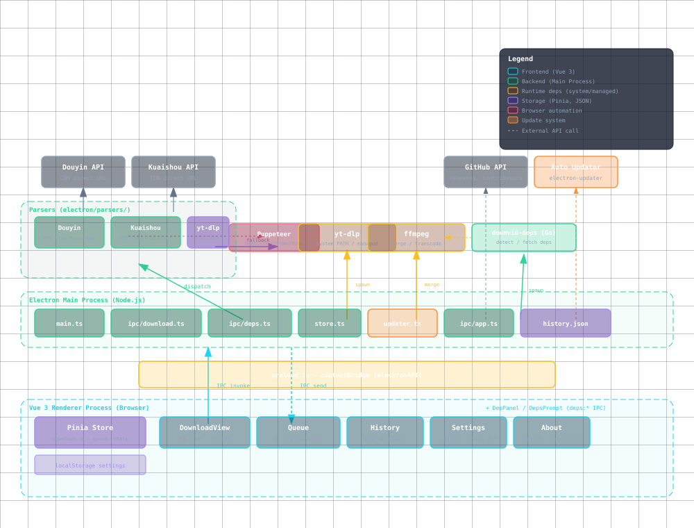

<div align="center">

# DownVid

**现代化的开源视频下载工具 — 一键下载全网无水印高清视频**

<p>
  <a href="https://github.com/yxxbc/downvid/releases"></a>
  <a href="https://github.com/yxxbc/downvid/releases/latest"></a>
  <a href="https://github.com/yxxbc/downvid/stargazers"></a>
  <a href="./LICENSE"></a>
</p>

<p>
  
  <a href="https://www.electronjs.org/"></a>
  <a href="https://vuejs.org/"></a>
  <a href="https://www.typescriptlang.org/"></a>
  <a href="https://go.dev/"></a>
  <a href="https://github.com/yt-dlp/yt-dlp"></a>
</p>

<br />


<br />

</div>

> 基于 [Videdown](https://github.com/cshuangyy/videdown) by cshuangyy (MIT License) 二次开发

---

> **⚠️ 免责声明**
>
> 本项目是 [yt-dlp](https://github.com/yt-dlp/yt-dlp) 的 GUI 套壳封装，仅提供图形界面，不包含任何破解或绕过技术保护措施的代码。
>
> 本工具仅供学习研究，请勿用于商业用途。下载内容需遵守当地法律法规，用户需自行承担使用责任。

---

## 📑 目录

- [项目简介](#-项目简介)
- [功能特性](#-功能特性)
- [支持的网站](#-支持的网站)
- [快速开始](#-快速开始)
  - [下载安装](#下载安装)
  - [从源码构建](#从源码构建)
- [文档](#-文档)
- [技术栈](#-技术栈)
- [架构图](#-架构图)
- [项目结构](#-项目结构)
- [贡献指南](#-贡献指南)
- [常见问题](#-常见问题)
- [更新日志](#-更新日志)
- [支持项目](#-支持项目)
- [开源协议](#-开源协议)
- [致谢](#-致谢)

---

## 📖 项目简介

**DownVid** 是一款现代化的开源视频下载工具，让你可以从抖音、小红书、B站、YouTube、Instagram 等网站下载无水印高清视频。

基于 **Electron** 构建跨平台桌面应用，使用 **yt-dlp** 作为下载引擎，DownVid 提供了简洁直观的界面和强大的功能，满足你的所有下载需求。

> ⚠️ DownVid 目前正在积极开发中，欢迎反馈任何 [问题](https://github.com/yxxbc/downvid/issues)。

---

## ✨ 功能特性

### 🌍 覆盖 1000+ 网站
以 [yt-dlp](https://github.com/yt-dlp/yt-dlp) 为下载引擎，支持 YouTube、B站、TikTok、Instagram 等几乎所有主流平台；抖音与快手另有专属解析器（平台 API 优先，headless 浏览器兜底），可拿到无水印直链。

### 🔧 运行依赖自动适配
安装包不内置 yt-dlp / ffmpeg。启动时自动识别机器上已安装的版本并直接复用（含 Homebrew、winget、scoop 等常见安装位置），缺失时可在界面上一键下载 —— 安装包体积因此大幅下降，也不会重复占用磁盘。

### ⚡ 实时下载进度
显示进度、速度、剩余时间与文件大小。抖音/快手直链走多连接分段下载（CDN 限速场景下显著提速），HLS/DASH 分片并发下载，支持暂停与断点续传。

### 🎛️ 多格式与多模式
可选 360P ~ 4K 各档清晰度；支持仅音频（转 MP3）、仅字幕（转 SRT）；支持 YouTube 多音轨选择。

### 🍪 Cookie 支持
自动读取已安装浏览器的登录态（Chrome / Edge / Firefox / Brave / Safari），也可手动导入 `cookies.txt`，用于需要登录的内容。

### 📥 下载队列与历史
队列化管理（暂停 / 恢复 / 重试），历史记录自动保存最近 100 条。

### 🔄 自动更新
基于 electron-updater 与 GitHub Releases。Windows / Linux 自动下载安装；macOS 因未做代码签名，改用自实现的下载校验与替换 `.app`（失败自动回滚）。

---

## 🌐 支持的网站

DownVid 通过 yt-dlp 支持 **1000+ 个**视频和音频平台。主要支持：

| 分类 | 平台 |
|------|------|
| 🇨🇳 **国内平台** | 抖音、B站（哔哩哔哩）、小红书、快手、西瓜视频 |
| 🌍 **国际平台** | YouTube、Instagram、TikTok、Twitter/X、Facebook |
| 📦 **其他** | 支持几乎所有 yt-dlp 支持的网站 |

完整支持列表请访问 [yt-dlp 支持网站](https://github.com/yt-dlp/yt-dlp/blob/master/supportedsites.md)。

---

## 🚀 快速开始

### 下载安装

1. 访问 [Releases](https://github.com/yxxbc/downvid/releases) 页面
2. 下载对应平台的最新版本安装程序
   - **macOS**: `.dmg` (ARM64 / x64)
   - **Windows**: `.exe` (x64)
   - **Linux**: `.AppImage` / `.deb` (x64 / ARM64)
3. 运行安装程序，按提示完成安装
4. 安装完成后即可使用

> 📖 详细的安装说明请查看 [安装指南](./docs/installation.md)

### 从源码构建

#### 环境要求

| 依赖 | 版本 | 用途 |
|------|------|------|
| [Node.js](https://nodejs.org/) | >= 22 | 构建前端与主进程 |
| [pnpm](https://pnpm.io/) | >= 8 | 包管理（勿用 npm / yarn，会破坏 workspace） |
| [Go](https://go.dev/) | >= 1.24 | 编译依赖边车 `backend/cmd/downvid-deps` |
| Git | — | — |

> yt-dlp / ffmpeg **无需**预先安装：运行时由边车自动识别，缺失时可在应用内一键下载。
> 想自己装一份也行（`brew install yt-dlp ffmpeg` / `winget install yt-dlp.yt-dlp Gyan.FFmpeg`），会被优先复用。

#### 1. 克隆并安装

```bash
git clone https://github.com/yxxbc/downvid.git
cd downvid
pnpm install
```

#### 2. 运行与构建

```bash
pnpm dev              # 开发模式（Vite + Electron 热重载，会自动编译 Go 边车）

pnpm build            # 构建当前平台安装包
pnpm build:mac:arm64  # 指定平台与架构，另有 :mac:x64 / :win / :linux:x64 / :linux:arm64
```

#### 3. 代码检查

```bash
pnpm vue-tsc --noEmit      # 前端类型检查
pnpm test                  # 纯逻辑单测（Vitest）
pnpm lint:ipc              # IPC 契约校验（三处同步）
cd backend && go vet ./... && go test ./...   # Go 边车
pnpm deps:manifest:check   # 依赖清单是否落后上游
```

> 📖 详细的构建说明请查看 [从源码构建指南](./docs/build-from-source.md)，改动流程见 [仓库规范](./docs/standards.md)。

---

## 📚 文档

| 文档 | 说明 |
|------|------|
| [安装指南](./docs/installation.md) | 各平台安装详解，包括 macOS/Windows/Linux 的安装步骤和常见问题 |
| [从源码构建](./docs/build-from-source.md) | 开发环境搭建、依赖下载、构建生产版本 |
| [故障排除指南](./docs/troubleshooting.md) | 各种问题的详细排查步骤和解决方案 |
| [常见问题 (FAQ)](./docs/faq.md) | 使用中的常见疑问解答 |
| [架构说明](./docs/architecture.html) | 进程结构、IPC 边界、下载与依赖解析流程 |
| [仓库规范](./docs/standards.md) | 分支/提交规范、Issue 与 PR 流程、改动落点清单 |
| [发布流程](./docs/release.md) | 版本语义、发布步骤、产物命名契约与回滚 |
| [贡献指南](./CONTRIBUTING.md) | 如何参与项目开发 |
| [安全政策](./SECURITY.md) | 如何报告漏洞、支持范围与安全边界 |
| [贡献者行为准则](./CODE_OF_CONDUCT.md) | 社区行为规范 |

---

## 🛠️ 技术栈

| 技术 | 版本 | 用途 |
|------|------|------|
| [Electron](https://www.electronjs.org/) | 44 | 跨平台桌面应用框架 |
| [Vue 3](https://vuejs.org/) | 3.5 | 渐进式 JavaScript 框架（`<script setup>`） |
| [TypeScript](https://www.typescriptlang.org/) | 5.9 | 类型安全（`strict` + `noUnusedLocals`） |
| [Tailwind CSS](https://tailwindcss.com/) | 4 | 实用优先的 CSS（CSS-first，无 config 文件） |
| [Vite](https://vitejs.dev/) | 8 | 前端构建与 Electron 双进程打包 |
| [Pinia](https://pinia.vuejs.org/) | 4 | Vue 状态管理 |
| [Go](https://go.dev/) | 1.24+ | 依赖边车：探测并复用系统已安装的 yt-dlp / ffmpeg |
| [yt-dlp](https://github.com/yt-dlp/yt-dlp) | 运行时解析 | 视频下载引擎（不随安装包分发） |
| [FFmpeg](https://ffmpeg.org/) | 运行时解析 | 音视频合并与转码（不随安装包分发） |
| [electron-builder](https://www.electron.build/) | 26 | 应用打包与发布 |
| [Vitest](https://vitest.dev/) | 5 | 纯逻辑单元测试 |

> **关于 yt-dlp / ffmpeg**：安装包不再内置这两个工具。启动时由 Go 边车按
> 「系统优先」的顺序识别机器上已安装的版本并直接复用；缺失时可在
> 「设置 → 运行依赖」里一键下载，安装包体积因此大幅下降。

---

## 📐 架构图

<details>
<summary>点击展开完整架构图（也可直接查看 <a href="docs/architecture.html">交互式版本</a>）</summary>
<br />



</details>

---

## 📁 项目结构

```
downvid/
├── backend/                # Go 依赖边车（探测 + 下载 yt-dlp / ffmpeg）
│   ├── cmd/downvid-deps/   # 入口：detect / fetch 两个子命令
│   └── internal/
│       ├── probe/          # 执行二进制并解析版本号
│       ├── runtime/        # 候选路径解析（系统优先，登录 shell 补 PATH）
│       ├── fetch/          # 下载、SHA-256 校验、原子安装
│       ├── manifest/       # 版本与哈希清单（由脚本生成）
│       └── cli/            # NDJSON 输出
├── electron/               # Electron 主进程
│   ├── main.ts             # 入口：窗口、生命周期、日志
│   ├── ipc/                # IPC 按域拆分：app / deps / download / history / system
│   ├── download/           # 下载实现：direct（CDN 直链）/ ytdlp / progress
│   ├── parsers/            # 平台解析：douyin / kuaishou / ytdlp / formats
│   ├── utils/              # runtime（边车）、binary（依赖解析）、cookies、browser
│   └── updater.ts          # 应用内更新（含 macOS 自实现替换 .app）
├── src/                    # 渲染进程（Vue 3 + Tailwind + Pinia）
│   ├── components/         # 视图与组件（含 DepPanel / DepsPrompt）
│   ├── composables/        # useErrorModal / useUpdater
│   ├── stores/             # Pinia：download（队列）、deps（运行依赖）
│   └── types/              # 共享类型
├── shared/app.ts           # 仓库坐标与外部链接的唯一来源
├── tests/                  # Vitest 纯逻辑单测
├── scripts/                # 清单生成、构建边车、IPC 契约校验
├── docs/                   # 安装、构建、故障排除、规范、发布、架构
└── .github/workflows/      # CI / CodeQL / 依赖审查 / 发布 / 依赖清单更新
```

构建产物（`dist/`、`dist-electron/`、`backend/build/`、`release/`）不入库。

---

## 🤝 贡献指南

欢迎贡献！请遵循以下步骤：

1. **Fork** 本仓库
2. 创建你的特性分支：`git checkout -b feature/AmazingFeature`
3. 提交你的更改：`git commit -m 'Add some AmazingFeature'`
4. 推送到分支：`git push origin feature/AmazingFeature`
5. 开启一个 **Pull Request**

### 开发规范

- 代码遵循 TypeScript 严格模式（前端）与 `gofmt` / `go vet`（Go 侧车）
- 提交信息遵循 [Conventional Commits](https://www.conventionalcommits.org/) 规范
- 新增功能请同步更新文档和 CHANGELOG

---

## ❓ 常见问题

### Q: 下载提示缺少 yt-dlp / ffmpeg？
A: DownVid 不再内置这两个工具，启动时会自动查找系统里已安装的版本；找不到就会弹出提示，点「下载并继续」即可自动装好（会校验 SHA-256，并放在 DownVid 自己的数据目录里，不污染系统）。也可以在「设置 → 运行依赖」里查看当前用的是哪个版本、来自哪里，并手动指定路径。

### Q: 为什么有些视频下载失败？
A: 部分平台需要登录才能访问，请在设置中导入浏览器 Cookie。也可能是 yt-dlp 版本过旧，尝试更新到最新版本。

### Q: 支持哪些视频画质？
A: 支持 360p / 480p / 720p / 1080p，具体取决于源平台提供的画质选项。也支持纯音频下载模式。

### Q: macOS 提示"无法打开，因为无法验证开发者"？
A: 首次安装时右键点击应用，选择"打开"，或在"系统设置 → 隐私与安全性"中点击"仍要打开"；若提示"已损坏"，在终端执行 `xattr -cr /Applications/DownVid.app`。首次成功打开后，DownVid 会自动移除自身的隔离属性，之后的应用内更新也会自动处理，无需重复操作。

> 📖 更多常见问题请查看 [常见问题 (FAQ)](./docs/faq.md)
> 
> 📖 遇到问题？查看 [故障排除指南](./docs/troubleshooting.md)

---

## 📝 更新日志

完整的版本记录见 [CHANGELOG.md](./CHANGELOG.md)。

### Unreleased
- ♻️ **不再内置 yt-dlp / ffmpeg**：新增 Go 依赖边车，启动时复用系统已安装的版本，缺失可在应用内一键下载（安装包体积大幅下降，仓库移除 Git LFS）
- 🛠️ 工程规范：补充安全政策、贡献者准则、仓库规范与发布流程；CI 增加 CodeQL 与依赖审查；引入纯逻辑单测与 IPC 契约校验

---

## 💖 支持项目

如果 DownVid 对你有帮助，欢迎请作者喝杯咖啡 ☕

<div align="center">
  
  <p><em>微信扫码赞赏 — 给 Black Cat 赞赏</em></p>
</div>

---

## 📄 开源协议

本项目基于 [MIT License](./LICENSE) 协议开源。

安全问题请按 [安全政策](./SECURITY.md) 私下报告，不要开公开 Issue。

基于 [Videdown](https://github.com/cshuangyy/videdown) (MIT License) 修改。

---

## 🙏 致谢

- [Videdown](https://github.com/cshuangyy/videdown) — 原始项目
- [yt-dlp](https://github.com/yt-dlp/yt-dlp) — 强大的视频下载引擎
- [FFmpeg](https://ffmpeg.org/) — 音视频处理解决方案
- [Electron](https://www.electronjs.org/) — 跨平台桌面应用框架
- [Vue.js](https://vuejs.org/) — 渐进式 JavaScript 框架
- [Tailwind CSS](https://tailwindcss.com/) — 实用优先的 CSS 框架
- [Claude Code](https://www.anthropic.com/claude) — AI 编程助手

---

## 🔗 友链

- [LinuxDo](https://linux.do) — 高质量的 Linux 中文社区

---

<div align="center">

如果这个项目对你有帮助，欢迎给个 ⭐ Star 支持一下！

Made with ❤️ by yxxbc

</div>
