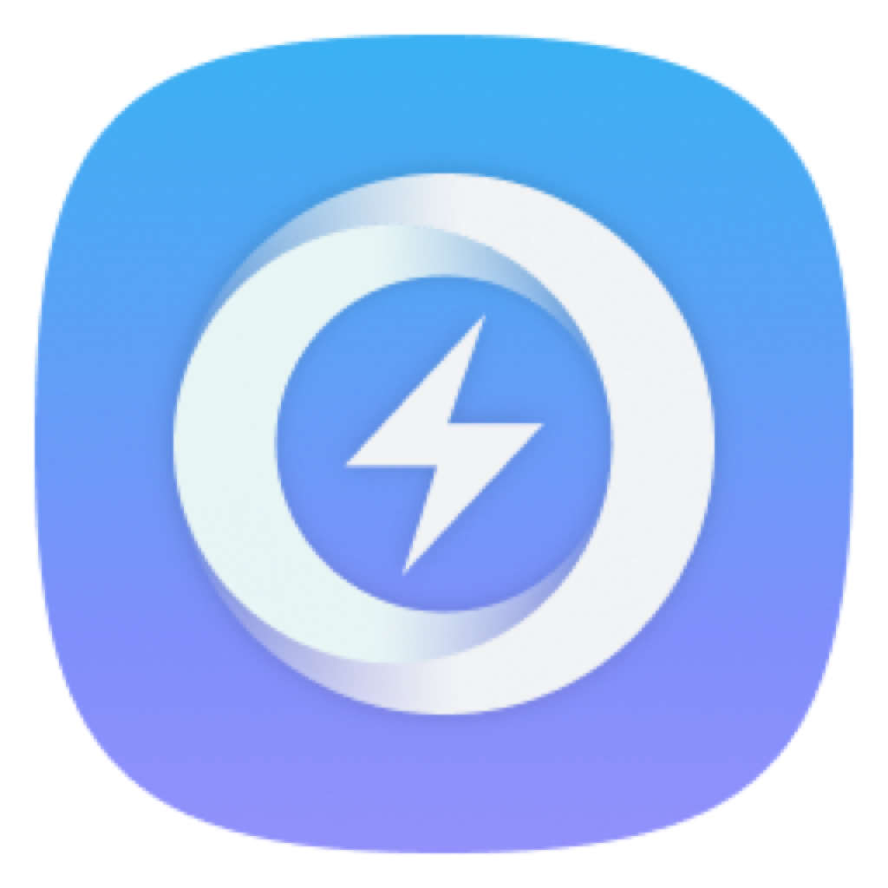
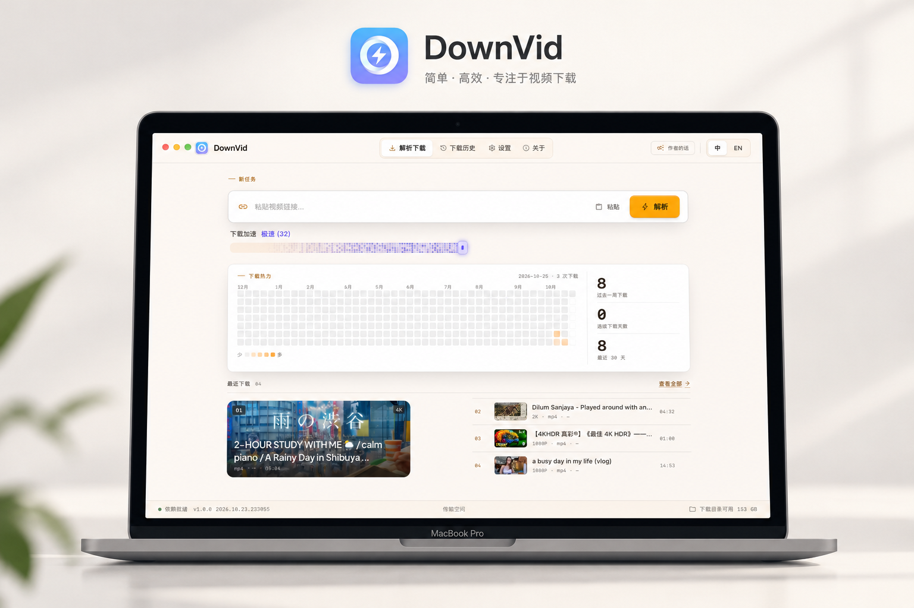
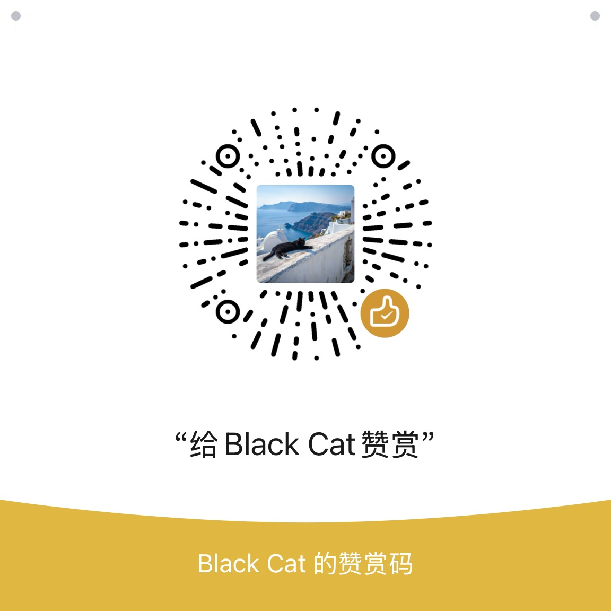

<p>
  <a href="./README.md">简体中文</a> | <a href="./README.en.md">English</a> | <strong>Türkçe</strong>
</p>
<div align="center">



<h1>DownVid</h1>

<p><strong>Beğendiğiniz videoları yerel olarak kaydedin.</strong></p>
<p>Açık kaynak · Çapraz platform · Sade</p>



<p>
  <a href="https://github.com/Downvid/downvid/releases"></a>
  <a href="https://github.com/Downvid/downvid/releases/latest"></a>
  <a href="https://github.com/Downvid/downvid/stargazers"></a>
  <a href="https://alternativeto.net/software/downvid/"></a>
  <a href="https://qm.qq.com/q/jmCfaELZ04"></a>
  <a href="https://github.com/Downvid/downvid/actions/workflows/codeql.yml"></a>
  <a href="./LICENSE"></a>
</p>

<p>
  <a href="https://downvid-coral.vercel.app">Web Sitesi</a>
  ·
  <a href="https://github.com/Downvid/downvid/releases">İndir</a>
  ·
  <a href="https://afdian.com/a/xynrin">Sponsor (Afdian)</a>
  ·
  <a href="https://github.com/Downvid/downvid/issues">Sorun bildir</a>
  ·
  <a href="https://qm.qq.com/q/jmCfaELZ04">QQ Grubu</a>
  ·
  <a href="./docs/installation.md">Kurulum rehberi</a>
</p>


<p>
  <a href="https://www.producthunt.com/products/github-460eee39-2e5c-447d-b207-531e944feebd?embed=true&amp;utm_source=badge-featured&amp;utm_medium=badge&amp;utm_campaign=badge-downvid" target="_blank" rel="noopener noreferrer"></a>
  <a href="https://trendshift.io/repositories/180707?utm_source=trendshift-badge&amp;utm_medium=badge&amp;utm_campaign=badge-trendshift-180707" target="_blank" rel="noopener noreferrer"></a>
</p>
</div>

---

## Sponsorluk ve iş birliği

DownVid işinize yarıyorsa, bakım ve sürekli güncellemeleri desteklemek için yazara bir kahve ısmarlayabilirsiniz:

<table>
  <tr>
    <td align="center" width="260" valign="top">
      <br /><br />
      <b>WeChat Pay Bahşiş</b>
    </td>
    <td align="center" width="260" valign="top">
      <a href="https://afdian.com/a/xynrin" target="_blank" rel="noopener noreferrer">
        
      </a><br /><br />
      <b><a href="https://afdian.com/a/xynrin" target="_blank" rel="noopener noreferrer">Afdian üzerinden sponsor ol</a></b>
    </td>
  </tr>
</table>

- ⚡ **Afdian**: [https://afdian.com/a/xynrin](https://afdian.com/a/xynrin)
- ☕ **WeChat Pay**: Yazara destek olmak için yukarıdaki QR kodu tarayın
- 💖 **Diğer sponsorluk seçenekleri**: [xynrin@icloud.com](mailto:xynrin@icloud.com?subject=%5BDownVid%5D%20Sponsor)
- 💼 **İş görüşmeleri / Reklamlar**: [xynrin@icloud.com](mailto:xynrin@icloud.com?subject=%5BDownVid%5D%20Business)

**Yazılım tamamen açık kaynaklıdır, reklam içermez ve asla içermeyecektir.** Sorunları veya önerileri lütfen [GitHub Issues](https://github.com/Downvid/downvid/issues) üzerinden bildirin.

---

## Topluluk

DownVid QQ grubuna katılmak için tıklayın: [https://qm.qq.com/q/jmCfaELZ04](https://qm.qq.com/q/jmCfaELZ04)

---

> [!IMPORTANT]
> Bu proje [yt-dlp](https://github.com/yt-dlp/yt-dlp) için bir grafiksel ön yüzdür. Teknik koruma önlemlerini
> kırmaya veya atlatmaya yönelik hiçbir kod içermez. Lütfen yerel yasalara, platform koşullarına ve
> telif hakkı kurallarına uyun; kullanım sorumluluğu size aittir.

## İçindekiler

- [Sponsorluk ve iş birliği](#sponsorluk-ve-iş-birliği)
- [Topluluk](#topluluk)
- [Hakkında](#hakkında)
- [Özellikler](#özellikler)
- [Desteklenen siteler](#desteklenen-siteler)
- [İndirme ve Kurulum](#indirme-ve-kurulum)
- [Kaynaktan derleme](#kaynaktan-derleme)
- [CLI](#cli)
- [Teknoloji yığını ve mimari](#teknoloji-yığını-ve-mimari)
- [Lisans](#lisans)

## Hakkında

**DownVid**, **macOS**, **Windows** ve **Linux** için modern, yüksek performanslı, açık kaynaklı bir masaüstü video indiricidir.

[yt-dlp](https://github.com/yt-dlp/yt-dlp) ve [FFmpeg](https://ffmpeg.org/) için grafiksel bir ön yüz olarak geliştirilmiş olup, komut satırı araçlarının karmaşıklığını ortadan kaldırır ve temiz, yerel ve reklamsız bir deneyim sunar.

### Neden DownVid?

- 🌐 **1000+ Platform Desteği**: YouTube, Bilibili, Douyin, TikTok, Xiaohongshu, Kuaishou, Twitter/X, Instagram ve daha fazlasından yüksek kaliteli video ve sesleri sorunsuzca çıkarır.
- ⚡ **Yerleşik Hızlandırma**: Optimize edilmiş çok parçalı iş parçacığı kuyrukları (16 iş parçacığına kadar) ve isteğe bağlı aria2 entegrasyonu ışık hızında indirmeler sağlar.
- 🔒 **Sıfır Reklam ve Gizlilik Odaklı**: Açılır pencere yok, paketlenmiş gereksiz yazılım yok, telemetri yok ve zorunlu filigran yok. MIT lisansı altında tamamen açık kaynak.
- 📦 **Otomatik Bağımlılık Yönetimi**: Yerleşik Go sidecar, yt-dlp / FFmpeg'i algılar ve yönetir; ortam değişkeni gerektirmeden `~/.downvid/runtime/bin` konumuna tek tıkla kurulum yapar.
- 🎨 **Modern Yerel Kullanıcı Deneyimi**: Svelte 5 ve Wails v2 ile tasarlanmış temiz Material 3 arayüzü.

## Özellikler

| Özellik | Açıklama |
| --- | --- |
| 1000+ Site | yt-dlp ile güçlendirilmiştir; Douyin ve Kuaishou için özel ayrıştırıcılar içerir |
| Kalite ve Biçimler | 360P'den 4K'ya, yalnızca ses (MP3), yalnızca altyazı (SRT) ve YouTube çoklu ses parçaları |
| İndirme Yöneticisi | Kuyruk yönetimi, duraklatma, devam ettirme, yeniden deneme, indirme ilerlemesi, hız, tahmini süre ve dosya boyutu |
| Hızlandırma | Parçalı işçi kuyruğu (varsayılan 8, en fazla 16 bağlantı), isteğe bağlı aria2 |
| Kimlik Doğrulamalı İçerik | Kurulu tarayıcılardan çerez içe aktarma veya `cookies.txt` içe aktarma |
| Çalışma Zamanı Bağımlılıkları | Manuel yolları ve `~/.downvid/runtime/bin` konumunu algılar; eksikse tek tıkla indirir |
| Geçmiş | Dosya yöneticisinde hızlı gösterim ile son 100 indirmenizi takip eder |
| Otomatik Güncelleme | Yerinde sessiz kurulum ile GitHub Releases üzerinden yerleşik güncelleyici |

## Desteklenen siteler

DownVid, yt-dlp aracılığıyla **1000+ siteyi** destekler:
- **Yerel (Çin)**: Douyin, Kuaishou, Xiaohongshu, Bilibili, Xigua
- **Uluslararası**: YouTube, TikTok, Instagram, Twitter/X, Facebook ve daha fazlası

## İndirme ve Kurulum

[**GitHub Releases**](https://github.com/Downvid/downvid/releases) üzerinden indirin:

| Platform | Önerilen Yükleyici | Taşınabilir / Güncelleme Arşivi | Açıklama |
|:---|:---|:---|:---|
| **macOS** | `DownVid-Wails-mac-universal-*.dmg` | `DownVid-Wails-mac-universal-*.zip` | Hem Apple Silicon hem de Intel için evrensel ikili dosya |
| **Windows** | `DownVid-Wails-windows-x64-*-installer.exe` | `DownVid-Wails-windows-x64-*.zip` | Kısayollu NSIS yükleyici veya taşınabilir zip |
| **Linux** | `DownVid-Wails-linux-x64-*.deb` | `DownVid-Wails-linux-x64-*.tar.gz` | Debian/Ubuntu paketi veya taşınabilir arşiv |

Ayrıntılı adımlar için [Kurulum Rehberi](./docs/installation.md) belgesine bakın.

## Kaynaktan derleme

### Ön koşullar

- Node.js ≥ 22
- pnpm ≥ 8
- Go ≥ 1.25
- Wails CLI v2.16

### Adımlar

```bash
git clone https://github.com/Downvid/downvid.git
cd downvid
pnpm install
pnpm --dir app/frontend install

# Gömülü sidecar ile bağımsız uygulamayı derle
bash app/scripts/build.sh

# Geliştirme sırasında canlı yeniden yükleme (sidecar olmadan)
(cd app && wails dev)
```

## CLI

Başsız `downvid <url>` komutu, masaüstü ayarlarını ve çalışma zamanı bağımlılıklarını
yeniden kullanır. macOS, Windows ve Linux'ta derleme ve kurulum adımları için
[CLI rehberine](./docs/cli.md) (Çince) bakın.

## Teknoloji yığını ve mimari

- **Çatı**: [Wails v2](https://wails.io/)
- **Çekirdek Motor**: [Go](https://go.dev/) (17 sıfır bağımlılıklı dahili paket)
- **Ön Yüz**: [Svelte 5](https://svelte.dev/) + Vite + Tailwind CSS v4
- **Motorlar**: [yt-dlp](https://github.com/yt-dlp/yt-dlp) ve [FFmpeg](https://ffmpeg.org/)
- **Güncelleyici**: [wmlUpdate](https://github.com/yxxbc/wmlUpdate) (kaynak yük devretme, devam ettirilebilir indirme, SHA-256 doğrulama)
- **Test**: [Vitest](https://vitest.dev/)

## Lisans

DownVid, [MIT Lisansı](./LICENSE) altında açık kaynaklıdır.

---

<div align="center">

<a href="https://github.com/Downvid/downvid">DownVid</a> · Xynrin tarafından özenle geliştirildi

</div>
