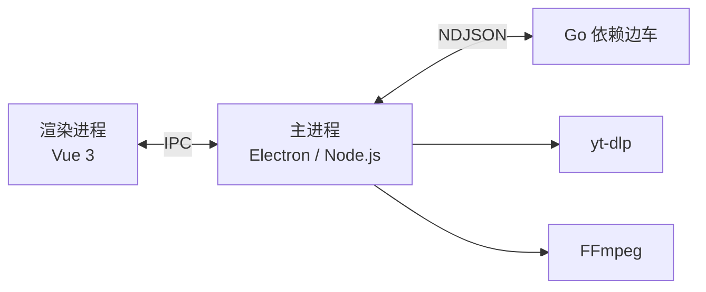

<div align="center">

<table>
  <tr>
    <td width="30%" align="center" valign="middle">
      
      <h1>DownVid</h1>
      <p><strong>把喜欢的视频，轻松保存到本地。</strong></p>
      <p>开源 · 跨平台 · 简洁易用</p>
    </td>
    <td width="70%" align="center" valign="middle">
      
    </td>
  </tr>
</table>

<p>
  <a href="https://github.com/yxxbc/downvid/releases"></a>
  <a href="https://github.com/yxxbc/downvid/releases/latest"></a>
  <a href="https://github.com/yxxbc/downvid/stargazers"></a>
  <a href="https://alternativeto.net/software/downvid/"></a>
  <a href="https://github.com/yxxbc/downvid/actions/workflows/ci-linux.yml"></a>
  <a href="https://github.com/yxxbc/downvid/actions/workflows/ci-macos.yml"></a>
  <a href="https://github.com/yxxbc/downvid/actions/workflows/ci-windows.yml"></a>
  <a href="https://github.com/yxxbc/downvid/actions/workflows/codeql.yml"></a>
  <a href="./LICENSE"></a>
</p>

<p>
  <a href="https://downvid-coral.vercel.app">官网</a>
  ·
  <a href="https://github.com/yxxbc/downvid/releases">下载 DownVid</a>
  ·
  <a href="https://github.com/yxxbc/downvid/issues">反馈问题</a>
  ·
  <a href="mailto:xynrin@icloud.com?subject=%5BDownVid%5D%20%E8%B5%9E%E5%8A%A9">赞助 / 商务合作</a>
  ·
  <a href="./docs/installation.md">安装指南</a>
</p>

<p>
  <strong>简体中文</strong> | <a href="./README.md">English</a>
</p>

<p>
  <a href="https://www.producthunt.com/products/github-460eee39-2e5c-447d-b207-531e944feebd?embed=true&amp;utm_source=badge-featured&amp;utm_medium=badge&amp;utm_campaign=badge-downvid" target="_blank" rel="noopener noreferrer"></a>
  <a href="https://trendshift.io/repositories/180707?utm_source=trendshift-badge&amp;utm_medium=badge&amp;utm_campaign=badge-trendshift-180707" target="_blank" rel="noopener noreferrer"></a>
</p>
</div>

---

## 赞助与商务合作

赞助支持，或商务合作（如广告位），请发邮件至 **xynrin@icloud.com**：

| 事宜 | 联系方式 |
| --- | --- |
| 赞助支持 | <a href="mailto:xynrin@icloud.com?subject=%5BDownVid%5D%20%E8%B5%9E%E5%8A%A9">xynrin@icloud.com</a> |
| 商务合作 / 广告位 | <a href="mailto:xynrin@icloud.com?subject=%5BDownVid%5D%20%E5%95%86%E5%8A%A1%E5%90%88%E4%BD%9C">xynrin@icloud.com</a> |

缺陷报告与功能建议请走 [Issues](https://github.com/yxxbc/downvid/issues)，这样其他人也能搜到答案。

**软件本身不含任何广告，将来也不会有。** 这里谈的是项目层面的合作 —— 例如本 README 或
[官网](https://downvid-coral.vercel.app) 上的展示位，与安装包里装了什么无关。

---

> [!IMPORTANT]
> 本项目是 [yt-dlp](https://github.com/yt-dlp/yt-dlp) 的图形界面封装，不包含破解或绕过技术保护措施的代码。请遵守当地法律法规、平台规则及内容版权要求，使用者需自行承担使用责任。

## 目录

- [赞助与商务合作](#赞助与商务合作)
- [项目简介](#项目简介)
- [功能特性](#功能特性)
- [支持的网站](#支持的网站)
- [下载安装](#下载安装)
- [从源码构建](#从源码构建)
- [文档](#文档)
- [技术栈与架构](#技术栈与架构)
- [项目结构](#项目结构)
- [常见问题](#常见问题)
- [参与贡献](#参与贡献)
- [Star History](#star-history)
- [开源协议与致谢](#开源协议与致谢)

## 项目简介

**DownVid** 是一款现代化、高性能、完全开源的跨平台桌面视频下载工具，原生支持 **macOS**、**Windows** 和 **Linux**。

本项目作为 [yt-dlp](https://github.com/yt-dlp/yt-dlp) 与 [FFmpeg](https://ffmpeg.org/) 的图形界面前端，抹平了复杂的命令行参数门槛，带来开箱即用、简洁无干扰的下载体验。

### 核心亮点

- 🌐 **全网 1000+ 站点支持**：深度覆盖主流短视频与长视频平台（抖音、快手、小红书、哔哩哔哩、YouTube、TikTok、X/Twitter、Instagram 等），支持无水印原画质提取。
- ⚡ **多路并发与下载加速**：直链采用智能分块并发队列调度（最高 16 路），支持断点续传；可选集成 aria2 多连接加速引擎。
- 🔒 **纯粹开源与注重隐私**：无任何弹窗广告、无捆绑插件、不添加平台强制水印、不收集用户隐私。基于 MIT 协议完全开源。
- 📦 **开箱即用依赖管理**：内置 Go 依赖边车，自动探测并使用系统已有工具；缺失时支持一键自动下载配置，无需折腾环境变量。
- 🎨 **精致现代视觉交互**：基于 Material 3 设计语言，界面纯粹干练，全平台提供流畅统一的视觉与操作体验。

项目仍在积极持续演进中。遇到问题或有功能建议，欢迎提交 [Issue](https://github.com/yxxbc/downvid/issues)。

## 功能特性

| 功能 | 说明 |
| --- | --- |
| 多平台解析 | 基于 yt-dlp 支持 1000+ 个视频和音频网站；抖音、快手另有专属解析器 |
| 清晰度与格式 | 支持 360P 至 4K、仅音频（MP3）、仅字幕（SRT）及 YouTube 多音轨选择 |
| 下载管理 | 队列管理、暂停、恢复、重试、下载进度、速度、剩余时间与文件大小 |
| 下载加速 | 直链使用小块工作队列（默认 8 路、上限 16 路），可选 aria2 多连接；HLS/DASH 分片并发 |
| 登录内容 | 支持读取已安装浏览器的登录状态，也可以手动导入 `cookies.txt` |
| 运行依赖管理 | 自动识别系统中的 yt-dlp / FFmpeg；缺失时可以在应用内下载 |
| 下载历史 | 自动保存最近 100 条下载记录 |
| 自动更新 | 通过 GitHub Releases 更新；macOS 使用应用内校验与替换流程 |

## 支持的网站

DownVid 通过 yt-dlp 支持 **1000+ 个**视频和音频网站。以下是常见平台示例：

| 国内平台 | 国际平台 |
| --- | --- |
| 抖音、小红书、快手、西瓜视频、哔哩哔哩（B 站） | YouTube、TikTok、Instagram、X（Twitter）、Facebook |

其他网站请参考 [yt-dlp 支持的网站列表](https://github.com/yt-dlp/yt-dlp/blob/master/supportedsites.md)。平台可用性可能随网站变化而变化。

## 下载安装

前往 [**GitHub Releases**](https://github.com/yxxbc/downvid/releases) 下载最新版本，并按操作系统选择对应安装包。

| 平台 | 安装包 |
| --- | --- |
| macOS | `.dmg`（ARM64 / x64） |
| Windows | `.exe`（x64） |
| Linux | `.AppImage` / `.deb`（x64 / ARM64，具体产物以 Release 页面为准） |

安装步骤与常见问题见 [安装指南](./docs/installation.md)。

### 用 Docker 运行

容器镜像跑的是**原生 WebUI**（没有 X11、没有 VNC）——浏览器打开就是完整应用，
电脑、平板、手机都能用：

```bash
# 拉官方多架构镜像（amd64 + arm64）
docker run -d --name downvid -p 6080:6080 \
  -v "$PWD/data/downloads:/data/downloads" \
  -v "$PWD/data/userdata:/data/userdata" \
  ghcr.io/yxxbc/downvid:latest
# 然后打开 http://127.0.0.1:6080/
```

或者用 compose（推荐，升级只要一条命令）：

```bash
curl -O https://raw.githubusercontent.com/yxxbc/downvid/main/docker-compose.yml
docker compose up -d
# 以后升级：docker compose pull && docker compose up -d
```

yt-dlp / FFmpeg / ffprobe 已在镜像内预装，且**版本与哈希和桌面版下载到的完全一致**。
下载文件落在宿主机的 `./data/downloads`。配置项、反向代理、升级与排错的完整说明见
[Docker 指南](./docs/docker.md)。

## 从源码构建

### 环境要求

- Node.js ≥ 22
- pnpm ≥ 8
- Go ≥ 1.24

yt-dlp 和 FFmpeg **无需预先安装**。运行时会优先探测并复用系统已有版本；缺失时可在应用内下载安装。

### 构建步骤

```bash
git clone https://github.com/yxxbc/downvid.git
cd downvid
pnpm install
pnpm dev       # 开发模式
pnpm build     # 构建当前平台安装包
```

更多平台构建命令、依赖说明及排错步骤请查看 [从源码构建指南](./docs/build-from-source.md)。

## 文档

| 文档 | 内容 |
| --- | --- |
| [安装指南](./docs/installation.md) | macOS、Windows、Linux 的安装说明 |
| [Docker 指南](./docs/docker.md) | 在容器中运行 DownVid，通过浏览器访问 |
| [从源码构建](./docs/build-from-source.md) | 开发环境、依赖与构建流程 |
| [故障排除](./docs/troubleshooting.md) | 常见错误与排查步骤 |
| [常见问题（FAQ）](./docs/faq.md) | 使用问题与解答 |
| [架构说明](./docs/architecture.html) | 进程结构、IPC 通信与下载流程 |
| [开发者指南](./docs/development.md) | 代码导读、请求生命周期、IPC 契约、调试手段 |
| [项目结构](./docs/project-structure.md) | 目录说明与代码维护位置 |
| [仓库规范](./docs/standards.md) | 分支、提交、Issue 与 PR 规范 |
| [服务端模式](./docs/server-mode.md) | Docker / WebUI 的设计依据与边界 |
| [架构治理](./docs/provenance/README.md) | 上游代码来源审计、目标架构、分阶段迁移 |
| [发布流程](./docs/release.md) | 版本与发布产物维护 |
| [贡献指南](./CONTRIBUTING.md) | 如何参与项目开发 |
| [安全政策](./SECURITY.md) | 安全问题的报告方式与处理范围 |
| [贡献者行为准则](./CODE_OF_CONDUCT.md) | 社区参与规范 |

## 技术栈与架构

### 技术栈

| 技术 | 用途 |
| --- | --- |
| [Electron](https://www.electronjs.org/) | 跨平台桌面应用框架 |
| [Vue 3](https://vuejs.org/) | 用户界面 |
| [TypeScript](https://www.typescriptlang.org/) | 类型安全 |
| [Tailwind CSS](https://tailwindcss.com/) | 界面样式 |
| [Vite](https://vitejs.dev/) | 开发与构建 |
| [Pinia](https://pinia.vuejs.org/) | 状态管理 |
| [Go](https://go.dev/) | 探测与安装 yt-dlp / FFmpeg 的依赖边车 |
| [yt-dlp](https://github.com/yt-dlp/yt-dlp) | 视频与音频解析引擎 |
| [FFmpeg](https://ffmpeg.org/) | 音视频合并与转码 |
| [Vitest](https://vitest.dev/) | 纯逻辑单元测试 |

### 架构概览



交互式架构图及详细说明见 [架构文档](./docs/architecture.html)。

## 项目结构

| 目录 | 作用 |
| --- | --- |
| `backend/` | Go 依赖边车，探测并安装运行依赖 |
| `electron/` | 主进程、IPC、下载实现、平台解析器与更新逻辑 |
| `src/` | Vue 3 渲染进程与界面 |
| `shared/` | 仓库坐标与外部链接的共享定义 |
| `tests/` | 自动化单元测试 |
| `scripts/` | 构建、清单生成及校验脚本 |
| `docs/` | 安装、构建、架构、维护与发布文档 |

完整目录说明见 [项目结构文档](./docs/project-structure.md)。

## 常见问题

<details>
<summary><strong>提示缺少 yt-dlp 或 FFmpeg，怎么办？</strong></summary>

安装包不会预置这两个工具。应用启动时会先探测系统中的可用版本；若未找到，可在提示窗口中下载安装，或前往「设置 → 运行依赖」管理。
</details>

<details>
<summary><strong>macOS 提示无法验证开发者，怎么办？</strong></summary>

首次打开时，可在 Finder 中右键点击应用并选择「打开」，或前往「系统设置 → 隐私与安全性」确认打开。若仍遇到问题，请参考 [故障排除指南](./docs/troubleshooting.md)。
</details>

<details>
<summary><strong>某些视频下载失败，怎么办？</strong></summary>

部分网站要求用户登录。请确认你有权访问该内容，并尝试在设置中读取浏览器登录状态或导入 `cookies.txt`。网站变更也可能影响解析成功率。
</details>

更多问题见 [FAQ](./docs/faq.md) 与 [故障排除指南](./docs/troubleshooting.md)。

## 参与贡献

欢迎提交 Issue、改进文档或发起 Pull Request。

提交前建议运行：

```bash
pnpm vue-tsc --noEmit
pnpm test
pnpm lint:ipc
```

更多流程请查看 [贡献指南](./CONTRIBUTING.md) 和 [仓库规范](./docs/standards.md)。

### 贡献者

感谢所有为 DownVid 做出贡献的人：

<a href="https://github.com/yxxbc/downvid/graphs/contributors">
  
</a>

## Star History

<a href="https://www.star-history.com/?repos=yxxbc%2Fdownvid&type=date&legend=bottom-right">
  <picture>
    <source media="(prefers-color-scheme: dark)" srcset="https://api.star-history.com/chart?repos=yxxbc/downvid&type=date&theme=dark&legend=bottom-right" />
    <source media="(prefers-color-scheme: light)" srcset="https://api.star-history.com/chart?repos=yxxbc/downvid&type=date&legend=bottom-right" />
    
  </picture>
</a>

## 开源协议与致谢

DownVid 基于 [MIT License](./LICENSE) 开源。

关于项目名称、Logo 及第三方托管服务的品牌使用规则，请参阅[品牌与商标使用政策](./TRADEMARKS.md)。

DownVid 最初基于 [Videdown](https://github.com/cshuangyy/videdown) 开发，之后经过了大量修改、重构与功能扩展。感谢原作者 cshuangyy 的开源工作；原项目的版权与许可声明保留在 [LICENSE](./LICENSE) 中。

感谢社区贡献者与项目依赖的维护者：

- [Videdown](https://github.com/cshuangyy/videdown) — 原始项目
- [yt-dlp](https://github.com/yt-dlp/yt-dlp) — 下载解析引擎
- [FFmpeg](https://ffmpeg.org/) — 音视频处理
- [Electron](https://www.electronjs.org/) · [Vue.js](https://vuejs.org/) · [Tailwind CSS](https://tailwindcss.com/) — 应用开发技术
- [Claude Code](https://www.anthropic.com/claude) — AI 编程助手

### 支持项目

如果 DownVid 对你有帮助，欢迎请作者喝杯咖啡。微信赞赏码：

<details>
<summary>展开赞赏码</summary>


</details>

#### 赞助与商务合作

赞助与商务合作的联系方式见上文[赞助与商务合作](#赞助与商务合作)一节。

---

<div align="center">

<a href="https://github.com/yxxbc/downvid">DownVid</a> · Made with care by yxxbc

</div>
